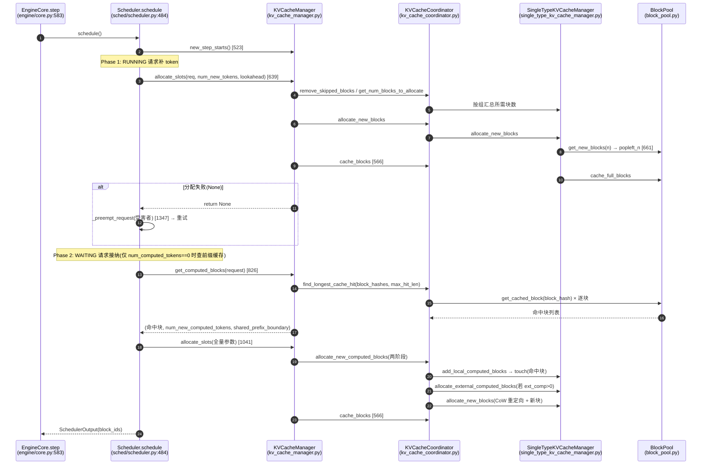
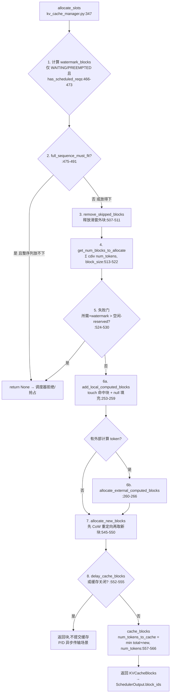
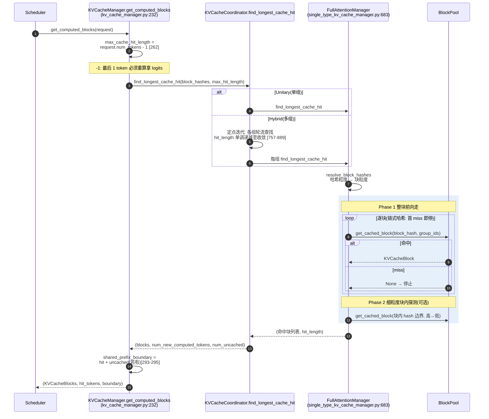
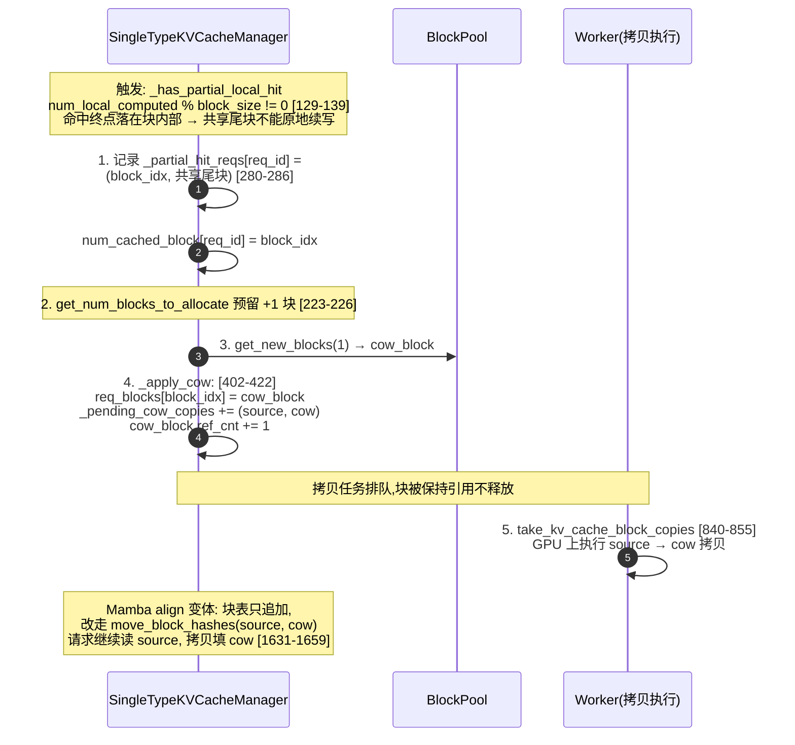
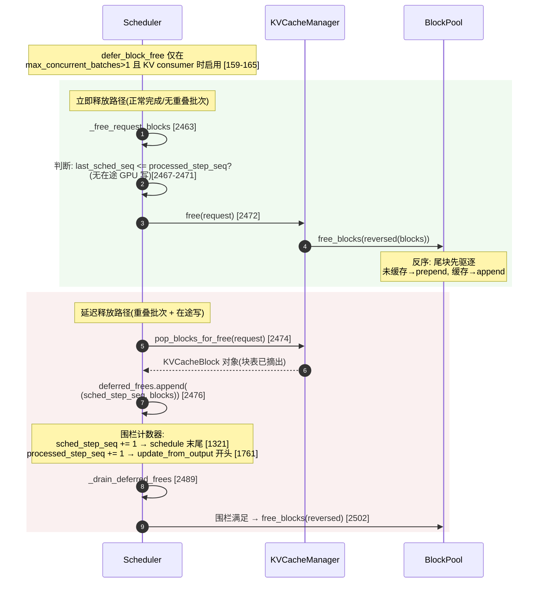
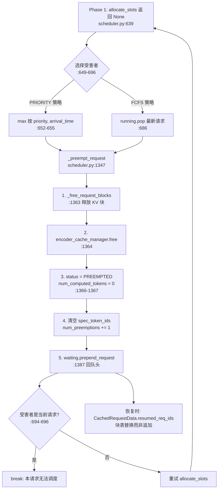
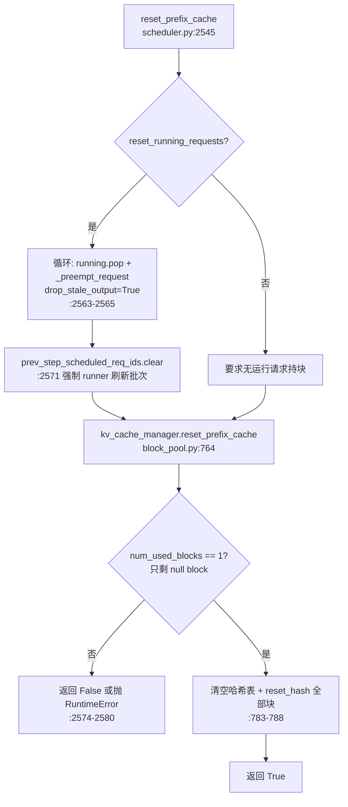
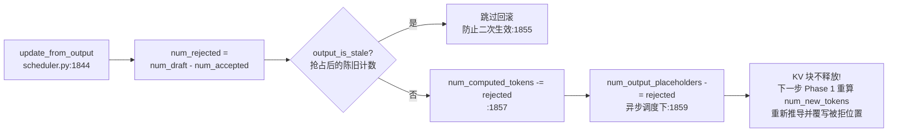
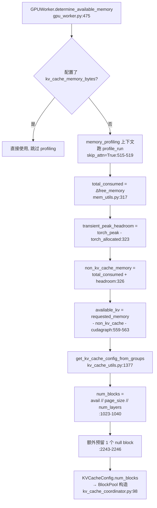

# vLLM KVCache-Block 关键代码调用逻辑图

> 基于 vLLM v1 源码绘制的关键调用链(含文件与行号)
> 配套文档:`vLLM-KVCache-Block管理分配逻辑详解.md`

---

## 图 1:一次调度步骤的全局调用链(时序图)

---

## 图 2:allocate_slots 内部八步流程(流程图)

---

## 图 3:前缀缓存查找(时序图)

---

## 图 4:部分命中 Copy-on-Write(时序图)

---

## 图 5:KVCacheBlock 状态机(状态图)

```mermaid
stateDiagram-v2
    [*] --> FREE: 初始化(全部块入空闲链表)
    state FREE {
        [*] --> FRONT: 未缓存块(prepend_n → 队首 LIFO)
        [*] --> BACK: 缓存块(append_n → 队尾 FIFO/LRU)
    }
    FREE --> ALLOCATED: get_new_blocks<br/>popleft_n 摘下, ref_cnt 0→1 [647-677]
    ALLOCATED --> CACHED: cache_full_blocks / cache_partial_block<br/>_insert_block_hash 设哈希 [225-342]
    CACHED --> FREE: free_blocks<br/>ref_cnt 归 0 → append_n(队尾, LRU)[719-743]
    ALLOCATED --> FREE: free_blocks(无哈希)<br/>ref_cnt 归 0 → prepend_n(队首, LIFO)
    FREE --> ALLOCATED: touch(前缀命中重新锚定)<br/>ref_cnt==0 → remove 摘出 + ref_cnt+1 [702-717]
    CACHED --> ALLOCATED: touch(命中后继续使用)
    CACHED --> FREE: _maybe_evict_cached_block<br/>仅清哈希, 不动 ref_cnt/链表 [679-700]
    ALLOCATED --> ALLOCATED: 多请求共享(ref_cnt > 1)
    note right of CACHED
        驱逐两层语义:
        ① 哈希驱逐 = 清哈希元数据(ref_cnt>0 也可发生)
        ② 物理复用 = 从队首 popleft(LRU)
    end note
```

---

## 图 6:释放与延迟释放围栏(时序图)

---

## 图 7:抢占流程(流程图)

---

## 图 8:reset_prefix_cache 流程(流程图)

---

## 图 9:推测解码拒绝回滚(流程图)

---

## 图 10:内存容量计算链(流程图)

---

## 附录:图中关键行号速查

| 调用 | 文件:行号 |
|---|---|
| allocate_slots 入口 | `kv_cache_manager.py:347` |
| Phase 1 调用点 | `scheduler.py:639` |
| Phase 2 调用点 | `scheduler.py:1041` |
| 前缀缓存查找 | `kv_cache_manager.py:232-298` |
| watermark 计算 | `kv_cache_manager.py:466-473` |
| 失败门 | `kv_cache_manager.py:524-530` |
| CoW `_apply_cow` | `single_type_kv_cache_manager.py:402-422` |
| free_blocks 双轨制 | `block_pool.py:719-743` |
| touch 重新锚定 | `block_pool.py:702-717` |
| 延迟围栏决策 | `scheduler.py:2463-2476` |
| 围栏排空 | `scheduler.py:2489-2502` |
| 抢占 | `scheduler.py:1347-1388` |
| 拒绝回滚 | `scheduler.py:1844-1865` |
| reset_prefix_cache | `scheduler.py:2545-2585` |
| num_blocks 公式 | `kv_cache_utils.py:1023-1040` |
| null block 创建 | `block_pool.py:190-191` |
